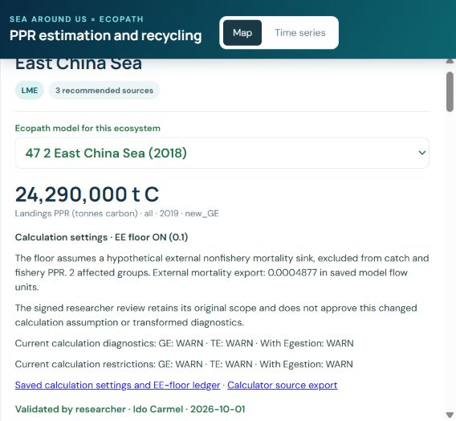

# Authorized EE-floor migration verification

All eight registered researcher-validated model/region pairs now explicitly record `use_ee_floor=True`, `ee_floor=0.1`. All 22 current engine method outcomes are present for each pair. The adopted migration contains 140 affected-method executions and 36 compatible retained outcomes. Guinea has no eligible groups below the floor, so all 22 of its results, including Monte Carlo, were retained. Humboldt retains `det_collapse_mode=auto`.

The floor is applied once after completed audited initialization. It changes only effective living EE/M0, an explicit hypothetical nonfishery external mortality export, and dependent detritus inflows/stock residuals. Production and both SPPR balance branches count the sink; catches, fishery weighting and fishery PPR exclude it. Canonical inputs and signed researcher decisions remain separate from this authorized calculation assumption.

Verification passed: 84 focused tests plus 11 subtests; 15 explicit-OFF LIM regressions; exact OFF reconciliation for all eight audited runtimes and saved GE/TE/With-Egestion matrices; matching ON experiment replay under the same valid-source eligibility; actual production/SPPR accounting, including diet imports and forced-balance copies. The original experiment also floored unknown-source EE for Eastern Tropical Pacific toothed whales; the production floor excludes that group. No source parameter or balance tolerance was changed to reconcile the difference.

The preservation audit verified 4,361 protected files and 358 unrelated regional workbooks, scientific tables, catches/mappings/allocation weights, Classic PPR, NPP, selections, signed reviews and unrelated central contents. The original captured central hash is authenticated in `qa/central_preservation.json.gz`. The capture used unordered set iteration for generated-sheet dictionary keys; all original table contents reproduce its exact hash under the recorded ordering. The current audit uses deterministic ordering.

The view audit compared 38,808 coefficients across map/trend payloads and 997,920 annual values against saved workbooks. Browser inspection verified all eight map, trend and source settings and preserved review boundaries. The map CSV is an actual browser download; trend CSV/JSON files exercise the shared provenance serializer against the actual eight-model payload. They are metadata verification fixtures, not additional scientific calculations. The map build reused all eight fresh 22-method packages without further stochastic draws.

The broad legacy engine test log records unavailable historical engine-local ToyModels/Black Sea fixture paths and zero-model directory tests depending on those paths. Its initial default-floor LIM expectation was corrected to explicit OFF; the separate 15-test LIM run passes. No scientific input was substituted. Root `structure.md` remains absent; `explainers/structure.md` is the applicable guide.

Regional Annual `ppr` values are native wet-weight equivalents; the existing ratio/view calculation divides by 9 for carbon equivalents. `after.json.gz` and each model report preserve both raw values and converted tonnes carbon. Browser display exclusions remain separate from the all-group workbook benchmark.

Remaining scientific limitations include Humboldt negative detritus stock residuals and GE/With-Egestion FAILs, Karnataka strict balance failures, Eastern Tropical Pacific strict TE imbalance, unsupported source scopes, unresolved symbolic methods, Monte Carlo restrictions and Bay `EwE_TE_EE` exceeding its recorded 180-second budget. Validation of the source model does not approve the new assumption or override these outcomes.

Each model report below contains all 22 before/after values, execution/retention status, scientific availability and evidence links.

| Pair | Evidence |
|---|---|
| HS_077 / `077HS_1_Eastern_tropical_Pacific_(1993-1997)` | [22-method report](<../../../../../../../../../../HS/HS_077/papers/ETP-2003/models/077HS_1_Eastern_tropical_Pacific_(1993-1997)/results/diagnostics/ee_floor/README.md>) |
| LME_013 / `Chiaverano2018_detailed_Northern_Humboldt_1995_1998` | [22-method report](<../README.md>) |
| LME_028 / `28_646_Guinea_(1998)` | [22-method report](<../../../../../../../../../LME_028/papers/GUI-2004/models/28_646_Guinea_(1998)/results/diagnostics/ee_floor/README.md>) |
| LME_032 / `32_1_Arabian_Sea_off_Karnataka_(2000)` | [22-method report](<../../../../../../../../../LME_032/papers/ARAB-2005/models/32_1_Arabian_Sea_off_Karnataka_(2000)/results/diagnostics/ee_floor/README.md>) |
| LME_034 / `34_1_Bay_of_Bengal_(1978)` | [22-method report](<../../../../../../../../../LME_034/papers/LME034-Guenette-2013/models/34_1_Bay_of_Bengal_(1978)/results/diagnostics/ee_floor/README.md>) |
| LME_035 / `35_412_Gulf_of_Thailande_(1963)` | [22-method report](<../../../../../../../../../LME_035/papers/Christensen-1998/models/35_412_Gulf_of_Thailande_(1963)/results/diagnostics/ee_floor/README.md>) |
| LME_036 / `36_1_South_China_Sea_SCS-2007_Northern_South_China_Sea_(2000s)` | [22-method report](<../../../../../../../../../LME_036/papers/SCS-2007/models/36_1_South_China_Sea_SCS-2007_Northern_South_China_Sea_(2000s)/results/diagnostics/ee_floor/README.md>) |
| LME_047 / `47_2_East_China_Sea_(2018)` | [22-method report](<../../../../../../../../../LME_047/papers/ECS-2022/models/47_2_East_China_Sea_(2018)/results/diagnostics/ee_floor/README.md>) |

Reproducible audit code is under `code/`; original capture, native pre-publication Project.xlsx, test logs and browser evidence are under `qa/`. `evidence_files.json` records their exact hashes. Original method-return files remain in each model-local `results/diagnostics/method_coverage/`. Retry packages were deleted only after all adopted files matched their exact hashes; model-local cleanup receipts retain that proof.

Exact unavailable legacy test fixtures:

- `tools/scientific_code/PPREstimation/real_models/ToyModels/900_900_Multi_DET_Toy_(2026).json`
- `tools/scientific_code/PPREstimation/real_models/new_EwE_jsons/62_10062_Black_Sea_(1960-1969).json`

All eight migration configurations and their canonical scientific sources were available. No missing source was substituted.

The original verification stdout is retained as `qa/preservation_native_stdout_raw_units.txt`: its historical `*_tC` keys contained the native wet-weight numbers before the reporting labels were corrected. `after.json.gz` and model reports explicitly retain raw wet weight and correctly converted carbon equivalents. The calculation workbooks and their conversion rules were not changed for this reporting correction.
