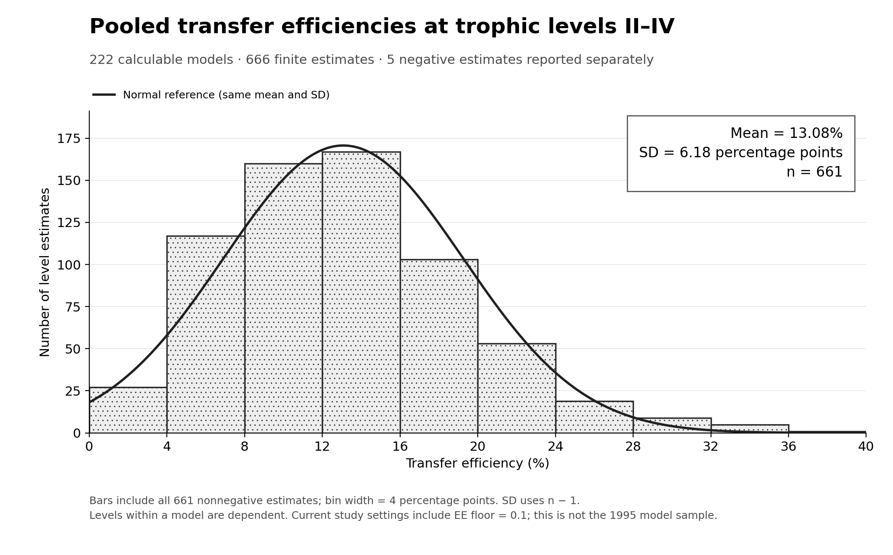
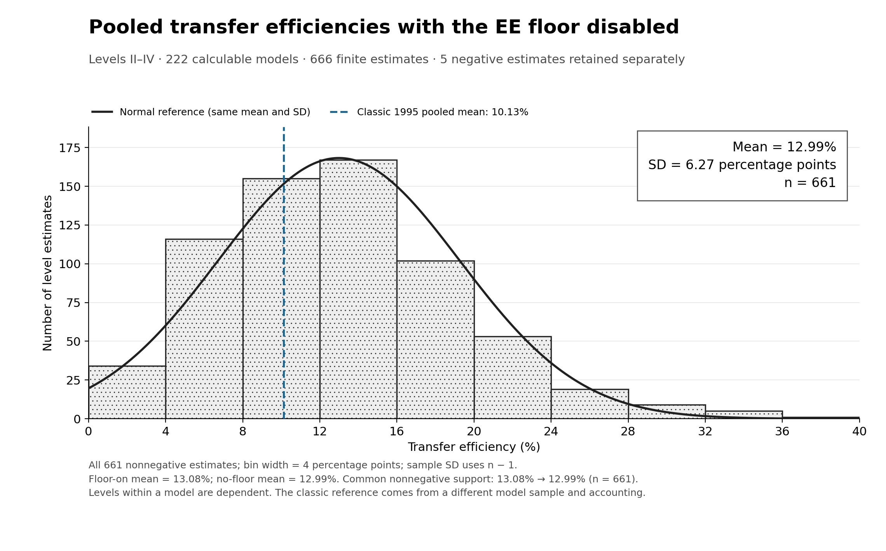

# Aggregated trophic-level transfer efficiency

This researcher-owned comparison evaluates three scalar transfer efficiencies in `PPRCalculator.SPPR_1995`: fixed TE = 0.1, the consumption-weighted arithmetic mean of consumer efficiencies, and the geometric mean of aggregated trophic-level efficiencies at levels II, III and IV. Each choice uses the same existing cycle-broken, detritus-basal continuous trophic level in `SPPR = TE^(1−TL)`.

The two populations have separate inputs, settings and results. Researcher validation applies only to the exact seven registered model-region pairs. The larger collection is a computational comparison and acquires no researcher approval from inclusion here.

## Seven researcher-validated pairs

The [runner](code/compare_validated.py) discovers the live signed registry and canonical regional models, verifies the exact [seven-pair cohort](../sppr_trophic_level_20261018_validated7/inputs/cohort.json), and retains each model's audited initialization and EE-floor settings. It runs the current calculator as an explicitly identified study calculation after audited loading. It does not alter scientific JSON, saved coefficients, regional workbooks, Project.xlsx, selections, signed reviews or generated views.

The cohort is Eastern tropical Pacific (HS_077), Northern Humboldt (LME_013), Arabian Sea (LME_032), Bay of Bengal (LME_034), Gulf of Thailand (LME_035), South China Sea (LME_036), and East China Sea (LME_047). Guinea's 1998 model remains excluded following the signed 18 October withdrawal. The Thailand identifier retains `1963`; that inherited name is not a claim about the model's documented period.

For each model, both catch-weighted comparisons use identical groups for all three options and retain signed-review group exclusions. The global consumer mean and the trophic aggregation use the whole runtime food web. Exclusions apply only to catch-weighted totals, not to the ecological calculation. All groups, including zero-catch groups and excluded groups, remain in the per-group output.

- **Model catch:** weights are the runtime model catch. Results include mean SPPR and the sum of native catch × SPPR. Native mass/area/time units are not established jointly with coefficients for six models, so no absolute unit conversion or cross-model sum is supplied. Humboldt has documented wet-weight density units.
- **Regional catch:** 2019 total catch includes landings and discards. Original taxon-to-group allocation shares are retained; excluded shares are not reassigned. Group catch is checked against the recent [seven-pair decomposition](../../../regions/LME/LME_028/work/2026-10-18_121535_trophic_aggregation_validated7/README.md). PPR is reported in wet-weight-equivalent tonnes and, following the regional convention, divided by 9 for tonnes of carbon.

The [comparison figure](results/validated7/comparison.png), [summary](results/validated7/summary.csv), [group data](results/validated7/group_records.csv), and [level-flow data](results/validated7/level_records.csv) show the results at their useful levels of detail. Tables retain numeric precision. [Full results](results/validated7/comparison.json) include exact flags, archived loader hashes, current calculator hash, review decisions, exclusions, warnings and retained method restrictions. [Source hashes](inputs/validated7/source_hashes.json) and [individual allocations](evidence/validated7/allocations_2019.json) support reproduction. The fixed-10% option must reproduce every saved group coefficient before results are written.

Bay of Bengal retains its source-fidelity/provisional conditions. Gulf of Thailand and South China Sea retain provisional size/stage allocation conditions. These comparisons neither replace those restrictions nor approve newly calculated efficiencies.

The level efficiencies and their geometric summary are percentages. `Mean Q` is the existing arithmetic mean of consumer-group TE weighted by consumption.

| Model | TE II | TE III | TE IV | Aggregated | Mean Q |
|---|---:|---:|---:|---:|---:|
| Eastern tropical Pacific | 23.16 | 20.29 | 14.06 | 18.76 | 22.49 |
| Northern Humboldt | 13.84 | 18.16 | 6.74 | 11.92 | 24.19 |
| Arabian Sea | 16.10 | 13.13 | 11.31 | 13.37 | 16.07 |
| Bay of Bengal | 11.22 | 9.87 | 16.22 | 12.16 | 11.84 |
| Gulf of Thailand | 11.53 | 8.24 | 17.04 | 11.74 | 15.35 |
| South China Sea | 6.10 | 11.96 | 13.52 | 9.96 | 6.69 |
| East China Sea | 7.36 | 12.97 | 6.00 | 8.31 | 8.36 |

PPR below is **million tonnes of carbon**, using the same 2019 catch allocations and exclusions for every column. Covered catch is 39,684,336.47 tonnes. These regional estimates should not be confused with sums of model-native density flows.

| Model | Fixed TE 0.1 | Mean Q | Aggregated |
|---|---:|---:|---:|
| Eastern tropical Pacific | 364.46 | 18.62 | 36.07 |
| Northern Humboldt | 167.61 | 19.16 | 107.49 |
| Arabian Sea | 356.89 | 85.86 | 148.65 |
| Bay of Bengal | 311.10 | 191.28 | 177.09 |
| Gulf of Thailand | 59.65 | 21.01 | 40.26 |
| South China Sea | 205.21 | 555.91 | 207.32 |
| East China Sea | 111.32 | 174.50 | 177.20 |
| **Total** | **1,576.23** | **1,066.33** | **894.07** |

Aggregated TE gives 43.28% less total PPR than fixed 10%, and 16.15% less than the consumption-weighted mean on this catch support. East China has zero native model catch, so its model-catch-weighted mean is unavailable; its regional-catch comparison above is complete. The [implementation checks](evidence/implementation_checks.json) record 122 passing focused/regression tests and independent level-ratio, geometric-mean, catch-support and unit checks.

The shared 2019 support contains **39,684,336.47 tonnes** of catch. Total PPR is **1.576 billion tC** with fixed TE = 0.1, **1.066 billion tC** with the consumption-weighted consumer mean, and **0.894 billion tC** with aggregated TE. The last two are 67.7% and 56.7% of the fixed-10% total, respectively.

| Model region | Consumer mean TE | Aggregated II–IV TE | Regional PPR ratio, aggregated / fixed 10% |
|---|---:|---:|---:|
| Eastern tropical Pacific | 22.49% | 18.76% | 0.099 |
| Northern Humboldt | 24.19% | 11.92% | 0.641 |
| Arabian Sea | 16.07% | 13.37% | 0.417 |
| Bay of Bengal | 11.83% | 12.16% | 0.569 |
| Gulf of Thailand | 15.35% | 11.74% | 0.675 |
| South China Sea | 6.69% | 9.96% | 1.010 |
| East China Sea | 8.36% | 8.30% | 1.592 |

East China has zero catch in its loaded model input, so its native catch-weighted mean and PPR comparison remain unavailable. Its regional 2019 catch comparison is complete. All seven models retain nonzero biomass accumulation and hypothetical external-mortality export in the detailed evidence; net migration is zero in these runtime models.

## Full EwE collection

The collection comparison is produced separately by [its runner](code/compare_collection.py), with outputs under `results/full_collection/`. Each discovered input and construction outcome is recorded. Failed construction and unavailable efficiencies remain explicit, and comparisons use common finite support. This population uses its own recorded loading configuration rather than borrowing the seven models' audited settings.

All **230** JSON files in the canonical `common_reference_data/ecobase/models/` collection were attempted. **229** load as ModelData and **222** construct calculators using the explicitly recorded current defaults: no diet normalization, no underdetermined solve, and EE floor enabled at 0.1. One file lacks `other_mort`; seven fail diet-sum validation. The final run had no file-write failures or timeouts. All 230 input hashes and the calculation code remained unchanged.

All 222 constructed models yield three finite level-flow ratios. Fixed-10% and consumer-mean SPPR are calculable for all 222; aggregated SPPR is calculable for **220**. Tasmanian Seamounts (407) and Galapagos Floreana (48) have negative level efficiencies, which remain in the raw tables and are rejected by the geometric summary. The constructed set contains 191 engine-balanced and 31 unbalanced models; numerical availability does not erase those flags.

Across the 220 models with usable aggregated TE, its median is **12.36%**, mean **12.40%**, interquartile range **9.13–15.41%**, and range **2.84–32.27%**. There are 666 finite individual level estimates, of which five are negative. All 666 together have arithmetic mean 12.19% and SD 19.78 percentage points; the 661 positive estimates no greater than 100% have mean **13.08%** and SD **6.18 percentage points**. This latter, explicitly filtered distribution is the closest descriptive analogue to the 1995 histogram. It is a different model collection and configuration, and levels within a model are dependent; the stored pooled SEM is descriptive rather than an independent-model confidence interval.

The paired catch comparison uses the same **202** models for all methods. Twelve constructed models have no positive catch and eight have negative catch entries; these remain outside catch-weighted comparisons. Both negative-TE models are within the negative-catch set. Results below are medians of per-model quantities, not ratios of summed density PPR.

| Choice | Median scalar TE on common 202 models | Median PPR / fixed-10% PPR |
|---|---:|---:|
| Fixed 0.1 | 10.00% | 1.000 |
| Consumer mean, Q weights | 18.49% | 0.213 |
| Aggregated II–IV | 12.45% | 0.616 |

The median paired aggregated/consumer-mean PPR ratio is **2.013**. This differs from the seven-model *summed regional* comparison above because the populations, catch weights and summary statistics differ.

- [Per-model comparison](results/full_collection/model_comparison.csv), [complete summary](results/full_collection/summary.json), and [paired ratios](results/full_collection/paired_ratios.csv).
- [All level flows](results/full_collection/level_flows.csv) and [all group coefficients](results/full_collection/group_sppr.csv).
- [Level-efficiency histograms](results/full_collection/level_te_histograms.png) ([SVG](results/full_collection/level_te_histograms.svg)); bars show bounded values, with each invalid outlier explicitly listed below its panel.
- [Paired PPR distributions](results/full_collection/paired_ppr_ratios.png) ([SVG](results/full_collection/paired_ppr_ratios.svg)).
- [Execution manifest](evidence/full_collection_manifest.json), [verification](evidence/full_collection_verification.json), [additional checks and exact exclusions](evidence/full_collection_additional_checks.json), and [stale-result guard checks](evidence/full_collection_manifest_checks.json).

### Pooled histogram of levels II–IV



The [pooled histogram](results/full_collection/pooled_te_histogram.png) ([editable SVG](results/full_collection/pooled_te_histogram.svg)) gives each model-level estimate equal weight. It pools the three individual efficiencies from every calculable model, before any model-level geometric averaging. Of 229 loadable models, 222 construct successfully and supply 666 finite estimates. Seven loadable models fail construction and cannot contribute estimates under these settings.

The main histogram contains **all 661 nonnegative estimates**, with arithmetic mean **13.08%** and sample SD **6.18 percentage points** (`ddof=1`). No zero or above-100% estimates occur. Bars are four percentage points wide; the line is a normal reference with the same mean and SD, scaled to histogram counts. It is descriptive, and does not establish normality or independence of the three levels from each model.

The five negative observations are shown separately below and preserved with their component flows in [negative_level_estimates.csv](results/full_collection/negative_level_estimates.csv). The one positive level-IV estimate from Galapagos Floreana remains in the main histogram.

| Model | Level | TE (%) |
|---|---:|---:|
| Tasmanian Seamounts Marine Reserve (407) | II | −467.5994 |
| Tasmanian Seamounts Marine Reserve (407) | III | −2.2182 |
| Tasmanian Seamounts Marine Reserve (407) | IV | −3.0372 |
| Galapagos, Floreana rocky reef (48) | II | −45.8928 |
| Galapagos, Floreana rocky reef (48) | III | −9.8660 |

Including all five negative values gives **n = 666**, mean **12.19%**, and sample SD **19.78 percentage points**. Each negative ratio has positive throughput but negative `predation + export`: signed exports outweigh the nonnegative predation term. These values are retained as diagnostic results and are unsuitable for the positive geometric summary used by SPPR.

The [plotting script](code/plot_pooled_te.py) reads the saved collection table without rerunning the models. Its [verification record](evidence/pooled_te_histogram.json) includes exact moments, bin edges/counts, all negative records, and source/output hashes. Checks independently reconstruct throughput and TE from the component flows and verify that all 666 observations appear in either the histogram or the separate negative table. The study retains its original balance flags and EE-floor setting; this distribution is not a reconstruction of the original 48-model sample.

### Sensitivity to disabling the EE floor

The [no-floor runner](code/compare_collection_no_floor.py) repeats construction and level-flow aggregation for all 230 canonical inputs, changing only `use_ee_floor=True` to `False`. All source bytes and the shared calculation-code hashes match the floor-enabled run. It retains the same other initialization settings, diet handling, cycle removal and export definition. It does not change project settings or rerun SPPR methods. The [manifest](evidence/full_collection_no_floor/manifest.json) and [execution verification](evidence/full_collection_no_floor/verification.json) record this separate research calculation.



| Population/configuration | Estimates in histogram | Arithmetic mean TE | Sample SD (percentage points) |
|---|---:|---:|---:|
| Classic 1995 figure | 140 | 10.13% | 5.81 |
| Current collection, EE floor 0.1 | 661 | 13.08% | 6.18 |
| Current collection, EE floor disabled | 661 | 12.99% | 6.27 |

**The mean moves closer to the classic result, but only slightly.** Disabling the floor lowers the mean by **0.0907 percentage points**, reducing its distance from 10.13% from **2.9490** to **2.8583 percentage points**. Both current histogram populations contain exactly the same 661 model-level observations. The SD increases slightly, moving farther from the classic figure's 5.81 percentage points. Numerical proximity of the pooled mean does not establish equivalence of the distributions or validate the current models.

The same 229 models load and 222 construct, yielding 666 finite estimates. The same five negative model-level estimates remain negative and are recorded in [the separate no-floor table](results/full_collection_no_floor/negative_level_estimates.csv). Including negatives gives mean **12.10%**, sample SD **19.81 percentage points**, and **n = 666**. The no-floor run retains 176 engine-balanced and 46 unbalanced models; those flags are separate from numerical availability and researcher validation.

| Model | Level | TE without the floor (%) |
|---|---:|---:|
| Tasmanian Seamounts Marine Reserve (407) | II | −467.7123 |
| Tasmanian Seamounts Marine Reserve (407) | III | −2.2380 |
| Tasmanian Seamounts Marine Reserve (407) | IV | −3.1100 |
| Galapagos, Floreana rocky reef (48) | II | −45.8940 |
| Galapagos, Floreana rocky reef (48) | III | −9.8663 |

The effect follows the export-inclusive definition: enabling the floor redirects some nonpredatory mortality from routed detritus into a hypothetical external export. Disabling it returns that flow to detritus. For the paired level results, feeding consumption, predation, respiration and total throughput remain unchanged within floating-point tolerance; the export change cancels the routed-detritus change. Thus `TE_off − TE_on = (export_off − export_on) / throughput`. An EE floor of 0.1 is not a TE floor of 0.1. The actual small pooled effect shows that this floor explains little of the gap between this collection's mean and the classic mean.

- [No-floor PNG](results/full_collection_no_floor/pooled_te_histogram.png) and [SVG](results/full_collection_no_floor/pooled_te_histogram.svg).
- [No-floor level flows](results/full_collection_no_floor/level_flows.csv), [paired nonnegative observations](results/full_collection_no_floor/paired_nonnegative_level_estimates.csv), and [loading/construction summary](results/full_collection_no_floor/summary.json).
- [Plot and pooled-statistic verification](evidence/full_collection_no_floor/pooled_te_histogram.json) and [independent paired-flow checks](evidence/full_collection_no_floor/paired_checks.json).

The comparison uses the same present-day corpus for both settings; the classic figure used 48 different models. Existing export, import and cycle conventions still apply. Disabling the EE floor alone does not recreate the historical calculation.

## Definition and interpretation

After cycle removal, let `D*[i,j]` be the normalized diet share of prey `j` in consumer `i`. Start basal PP, DET and Import groups at `a[i,1]=1`, and consumer groups at zero. For successive levels calculate `a[i,k+1] = sum_j D*[i,j] a[j,k]`. A group feeding 40% as a herbivore and 60% as a carnivore therefore contributes those fractions of its flows to levels II and III. This is a decomposition of paths through the food web, not rounding the group's mean trophic level. Each flow at level `k` is the sum of its group flows weighted by `a[i,k]`.

The helper decomposes the food web into discrete trophic levels and reports predation, export, respiration and flow to detritus. At each level, TE is `(predation + export) / (predation + export + respiration + flow_to_detritus)`. Exports include catch, net migration, detrital export and the current hypothetical external-mortality sink. Flow to detritus is natural mortality plus egestion minus detrital export. Biomass accumulation is retained in the group evidence but is not counted as export. The default strips cycles using the existing flow-cycle operation before trophic partitioning, with removed cyclic flow recorded.

### How the group flows become level flows

Use predator rows and prey columns throughout. For consumer `i`, total consumption is `q_i = B_i × (Q/B)_i`. Its feeding flow from prey `j` is `Z[i,j] = q_i × DC[i,j]`. The default helper removes feeding cycles to produce `Z*`, then forms `D*[i,j] = Z*[i,j] / sum_j Z*[i,j]`; empty feeding rows stay zero. The level fractions `a[i,k]` above are computed from this remaining, normalized diet.

For a donor group `i`, its outgoing predation is the **column sum**, `P_i = sum_r Z*[r,i]`: the amount of group `i` consumed by all predators `r`. Its own consumption is a row sum and is a different quantity. Its export is `E_i = catch_i + net_migration_i + det_export_i + external_mortality_export_i`, using the calculator's signed runtime quantities. The explicit external-mortality sink has already been removed from `M0`, and detrital export is subtracted from the routed detritus flow, preventing double counting.

Apply the donor group's level fractions to every outgoing flow:

```text
predation_k        = sum_i a[i,k] × P_i
exports_k          = sum_i a[i,k] × E_i
respiration_k      = sum_i a[i,k] × respiration_i
flow_to_detritus_k = sum_i a[i,k] × (M0_i + egestion_i − det_export_i)
throughput_k       = predation_k + exports_k + respiration_k + flow_to_detritus_k
TE_k               = (predation_k + exports_k) / throughput_k
```

For example, an omnivore eating 40% basal material and 60% pure herbivores has `a[i,II]=0.4` and `a[i,III]=0.6`. If predators consume 10 flow units of that omnivore and its exports total 2, it contributes predation **4** and exports **0.8** to level II, and predation **6** and exports **1.2** to level III. Sum these contributions over all groups to obtain the level totals. The same partition applies to respiration and detritus. All terms within a model retain the same native flow units, which cancel in TE; flows from different models are never summed to make this histogram.

Level-II TE describes the fraction of level-II throughput forwarded to level III or exported; level-III and level-IV efficiencies use the analogous outgoing flows. The helper's `consumption_k` is also available, but the denominator is the summed outgoing throughput above. Biomass accumulation, cycle removal and model imbalance can prevent it from equaling consumption.

This follows the export-inclusive definition in section 7.2 of the [EwE manual](https://www.vliz.be/imisdocs/publications/395938.pdf). [Pauly and Christensen (1995)](https://www.seaaroundus.org/wp-content/uploads/2015/04/PrimaryProductionRequiredToSustainGlobalFisheries.pdf) pooled 140 trophic-level estimates from 48 models in a histogram with an arithmetic mean. This study's geometric summary `(TE_II * TE_III * TE_IV)^(1/3)` is the explicitly chosen model-level summary and follows the averaging form used by the [pinned modern EwE summary](https://github.com/Official-EwE/Eii.Ecopath/blob/9d91a4d34b5e9500b010f811b47226ff044a3b4f/Sources/EwECustomPlugins/EwENetworkAnalysis/Interface/TrophicLevelDecomp/cTransferEfficiency.vb#L121). However, its [level-efficiency calculation](https://github.com/Official-EwE/Eii.Ecopath/blob/9d91a4d34b5e9500b010f811b47226ff044a3b4f/Sources/EwECustomPlugins/EwENetworkAnalysis/NetworkAnalysis/cNetworkManager.vb#L968) uses catch plus predation, rather than all exports plus predation, in the numerator. This project's helper also retains its existing cycle-removal algorithm and treats Import as a basal source, which differ from that implementation. These results are therefore not presented as bit-for-bit reproduction of the modern EwE summary. The three required levels are never silently dropped; undefined, nonpositive or otherwise invalid level efficiencies make the geometric summary unavailable.

The new API retains the old calls and adds one explicit option:

```python
level_flows = calculator.get_aggregated_TE()  # II, III, IV and their component flows
fixed = calculator.SPPR_1995(global_TE=0.1)
mean_Q = calculator.SPPR_1995(global_TE='mean', weights='consumption')
aggregated = calculator.SPPR_1995(TE_option='aggregated')
```

The last call uses `SPPR_i = TE_aggregated^(1-TL_i)` with the existing cycle-broken continuous `TL_i`. The detailed [calculator explanation](../../../explainers/sppr_methods.md#get_aggregated_televels2-3-4--break_cyclestrue) also describes input validation, missingness and the alternative `break_cycles=False` helper setting.

Reproduce from the repository root with the scientific Python dependencies:

```powershell
python research/human/aggregated_transfer_efficiency_20261018/code/compare_validated.py --prepare-only
python research/human/aggregated_transfer_efficiency_20261018/code/compare_validated.py
python research/human/aggregated_transfer_efficiency_20261018/code/plot_validated.py
python research/human/aggregated_transfer_efficiency_20261018/code/verify_validated.py
python research/human/aggregated_transfer_efficiency_20261018/code/compare_collection.py
python research/human/aggregated_transfer_efficiency_20261018/code/plot_pooled_te.py
python research/human/aggregated_transfer_efficiency_20261018/code/compare_collection_no_floor.py
python research/human/aggregated_transfer_efficiency_20261018/code/plot_pooled_te_no_floor.py
python research/human/aggregated_transfer_efficiency_20261018/code/verify_floor_effect.py
```

Each runner writes only its study outputs. Consumed input hashes are rechecked before saving. The original signed diagnostics remain historical review evidence; current calculation outcomes and diagnostic eligibility remain separate.
