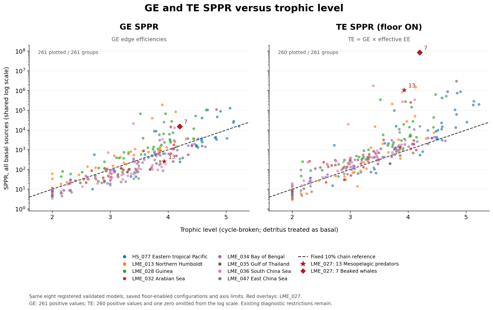
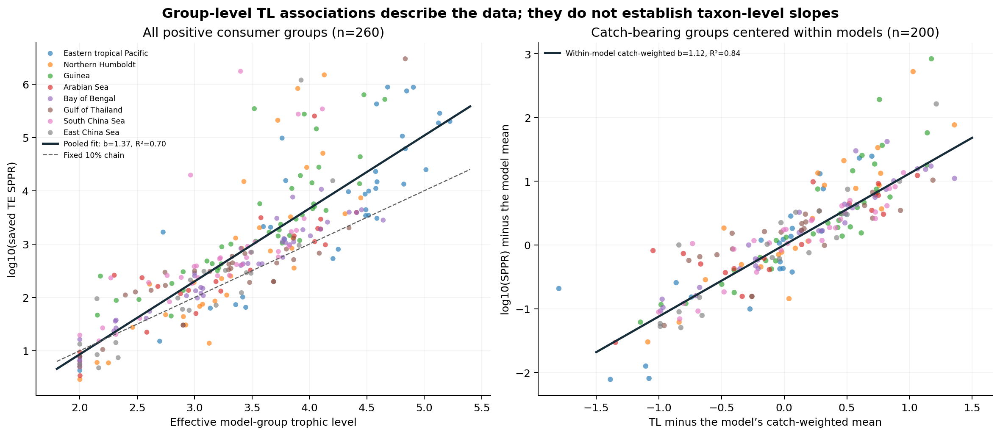
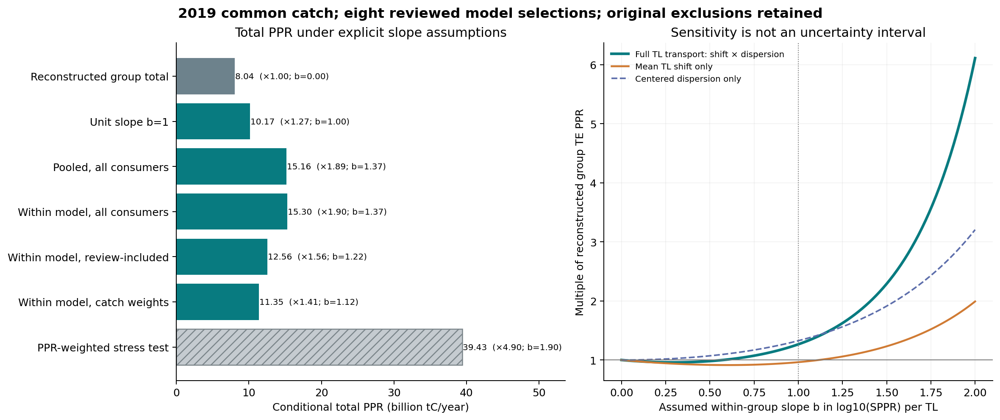

# Estimating PPR at taxon resolution

This analysis asks how much the primary production required by the same catch would change if `SPPR_new`, with `TE_option='TE'`, could represent the catch taxa more faithfully. The target is the total change in PPR. Jensen's inequality explains one component of that change, but it is not the target itself.

The useful distinction is between **an observed comparison**, **a conditional finer-resolution prediction**, and **the ecological quantity we ultimately want to estimate**. The first can be calculated from saved data. The second requires an explicit rule for predicting taxon coefficients. The third also requires evidence that this prediction describes the biological flows that were lost when species were grouped.

All empirical totals here refer to the same eight-model cohort in 2019, total catch including discards, `all` basal sources, unidentified treatment `method`, and the signed-review default group exclusions. They are not a measured world total. The saved floor-enabled calculations and their diagnostic restrictions remain in force.

**Main numerical finding:** the present group-coefficient reconstruction is **8.039 billion tonnes of carbon**. Transferring the experiment's between-group TL relationship to taxa predicts **11.355 billion tC (1.412 times baseline)** with a catch-weighted fit, **12.562 billion tC (1.563 times)** with an unweighted fit to review-included groups, or **15.303 billion tC (1.904 times)** with an unweighted fit to all positive consumer groups. These predictions include both mean TL differences and Jensen curvature. They are conditional scenarios, not a validated range for true PPR. The experiment makes the scenarios data-informed; it does not establish the missing species-level network response.

## 1. The target in ordinary language

SPPR is the production cost assigned to one unit of harvested biomass. PPR is that cost multiplied by the amount harvested, then summed over the catch. Imagine each taxon has a different price per tonne. The current calculation assigns the same price to all taxa mapped to a model group. We want to know the total bill if each taxon received its own defensible price.

Let `g` identify a group within a particular ecosystem, `c_ig` be the catch of taxon `i` allocated to that group, and `C_g = sum_i c_ig`. Fractions assigned to excluded groups remain excluded; allocations are not renormalized. Let `S_g` be the saved group TE SPPR and `s*_ig` the unknown taxon coefficient in a sufficiently resolved model.

\[
PPR_0=\frac{1}{9}\sum_g C_gS_g,
\qquad
PPR_* =\frac{1}{9}\sum_g\sum_i c_{ig}s^*_{ig}.
\]

The factor of nine converts the project's wet-weight-equivalent accounting to tonnes of carbon. It cancels in every ratio in this report. The desired resolution factor is

\[
K_* = PPR_*/PPR_0.
\]

A value of 1.4 would mean the finer-resolution estimate is 40% above the current estimate. Equivalently, the current estimate would be 28.6% below that finer estimate; these percentages have different denominators.

The term "true PPR" needs an accounting boundary. Here it means the PPR of the same catch under a defensible finer food web and the chosen TE accounting convention. It is not automatically the additional primary production that would occur if fishing stopped, or a quantity directly measured by the current regression. A statement about its expected value requires a model for the unobserved taxon flows and their uncertainty, not just a choice of numerical solver.

## 2. What is already measured in the saved data

The 2019 comparison covers 44,153,491.45 tonnes of catch, 200 catch-bearing groups, and 2,018 ecosystem–taxon records. The latter are not 2,018 distinct biological species. Catch taxa can include broader categories, and the same taxon can occur in more than one ecosystem.

| Calculation on the same catch | PPR, billion tC |
|---|---:|
| Classic formula using the saved model-group coefficients | 1.815041 |
| Classic formula using each group's catch-weighted mean taxon TL | 2.560937 |
| Classic formula applied separately to catch taxa | 3.168634 |
| Reconstructed PPR from saved `SPPR_new` group coefficients, TE, all sources | 8.038957 |

These are four different calculations, not four observations of truth. In particular, the larger network estimate does not become correct merely because it is larger. Several saved coefficients have WARN, provisional, implausibility, or other restrictions.

The 8.039 billion tC baseline is an arithmetic reconstruction from finite group coefficients and catch. It does not override annual-result availability flags. In particular, Guinea's saved annual TE result remains unavailable under its implausibility restriction, even though its finite group coefficients can be inspected in this diagnostic exercise. Researcher validation of model extraction and the signed diagnostic report is not approval of every resulting annual TE total.

The earlier decomposition established

\[
\frac{PPR_{\mathrm{classic,taxon}}}{PPR_{\mathrm{classic,group}}}
=1.745765
=1.237295\times1.410953.
\]

The first component is the within-group convexity effect. The second is the difference between the catch taxa's mean trophic levels and the actual saved model-classic coefficients, including trophic-level conventions. Thus the approximately twofold classic discrepancy is not all a Jensen effect.

## 3. Jensen's inequality, explained without changing the question

The classic formula is

\[
f(T)=10^{T-1}.
\]

It is curved upward: increasing TL by one multiplies cost by ten. An increase above the mean adds more cost than an equal decrease below the mean removes. That is why calculating each taxon's cost and then averaging gives a larger result than calculating the cost at the average TL.

Write `w_ig = c_ig/C_g` and `mu_g = sum_i w_ig T_i`. The pure within-group factor is

\[
J_g(1)=
\frac{\sum_iw_{ig}10^{T_i-1}}
     {10^{\mu_g-1}}
=\sum_iw_{ig}10^{T_i-\mu_g}\ge1.
\]

The inequality follows from `f''(T) = (ln 10)^2 f(T) > 0`. Equality holds when all positively weighted taxa have the same TL.

The condition matters: Jensen compares the distribution with **its own mean**. A model group's TL need not equal the catch-weighted taxon mean. If its operative classical TL is `T_g`, the full classic taxon/group factor for that group is

\[
10^{\mu_g-T_g}J_g(1).
\]

The mean-shift factor can be below one. Even without any within-group spread, a difference of `log10(2) = 0.30103` TL produces a twofold classic difference. Conversely, under an illustrative normal TL distribution with coincident means, `J=2` would correspond to a standard deviation of about 0.511 TL. Neither explanation can be inferred uniquely from the aggregate ratio alone. The actual finite taxon distribution is available here, so the analysis does not need the normal approximation.

## 4. Why the network method can already contain the mixture cost

The new method uses each consumer's effective efficiency

\[
TE_i=(P_i-M0_i)/Q_i,
\qquad A_{ij}=DC_{ij}/TE_i.
\]

Selecting `TE_option='TE'` does not select a universal efficiency of 0.1. The value follows the saved model's effective production, consumption and mortality. Under this option, detritus costs use direct PP/import ancestry, with the documented special treatment of EE-zero dead ends; they do not use the GE detritus recycling equation.

Separate living consumers `L` and basal sources `B`. With source costs `s_B`, the equations are

\[
s_L=A_{LL}s_L+A_{LB}s_B,
\qquad
s_L=(I-A_{LL})^{-1}A_{LB}s_B.
\]

For a nonnegative convergent network, the inverse expands into

\[
s_L=(I+A_{LL}+A_{LL}^2+\cdots)A_{LB}s_B.
\]

These terms sum the costs of different food paths and living feedback. The calculation does not first replace every path by a single average trophic depth. This is why an additional exponential-TL correction can sometimes count a mixture twice.

Consider two equally caught, equally consuming terminal taxa. Both have TE 0.1. Taxon A eats primary producers, giving TL 2 and SPPR 10. Taxon B eats another herbivore with SPPR 10, giving TL 3 and SPPR 100. Their mean cost is 55. The aggregate diet is half primary producers and half herbivores, so the group network calculation is

\[
S_g=(0.5\times1+0.5\times10)/0.1=55.
\]

Its classic coefficient is only `10^1.5 = 31.62`. Thus the classic taxon/group ratio is 1.739 while the network taxon/group ratio is exactly 1. This is a counterexample to a universal correction rule, not evidence that the real models have no resolution bias.

## 5. What the trophic-level experiment contributes

The [original experiment](../sppr_trophic_level_20261016/README.md) includes 261 consumer groups from eight registered model-region pairs, including unfished groups. Of these, 260 TE coefficients are positive and can enter logarithmic fits; one zero is retained in the source data but cannot be logged. Its figure places group TL on the horizontal axis and saved SPPR on a logarithmic vertical axis.

The TE panel supports a strong broad association: higher-TL groups usually have higher costs. Fitting all 260 positive TE values gives a pooled base-10 slope of 1.367036 and a log-scale R-squared of 0.699323. Allowing ecosystem-specific intercepts gives a common within-ecosystem slope of 1.374115. The latter still compares different functional groups; it does not measure differences between species inside one group.

In this descriptive relationship, one additional TL is associated with roughly `10^1.374 = 23.7` times the SPPR, rather than the classic factor ten. This is a chain-equivalent slope, not an estimate of an observed universal TE. The implied reciprocal factor must not be substituted into the calculator as if it were a measured efficiency.

The original experiment did not fit these slopes; they are additional analyses in this study. Its existing Spearman correlations and TL-bin summaries describe association. The new regressions explicitly compare sample selection, ecosystem effects and weighting. There are eight shared food webs, not 260 independent ecosystem replicates.

The left panel describes all positive consumer groups. The right panel shows the catch-weighted relationship after removing each ecosystem's own mean. Removing ecosystem means prevents differences in average ecosystem cost from determining this slope. It still does not turn a comparison between functional groups into an observation within a taxonomic group.

The figure also shows the limits of TL. In the separate LME_027 overlay, mesopelagic predators have TL about 3.93 but floor-ON TE SPPR about 1.06 million, compared with GE SPPR about 254. The saved TE self-loop gain is 0.990717, giving an algebraic amplification of about 107.7. This overlay is not part of the eight-model regression or PPR cohort. It illustrates that feedback can change SPPR enormously without a corresponding change in the cycle-pruned TL coordinate.

The x-coordinate and y-coordinate deliberately retain different information: TL is recovered from the cycle-pruned fixed-10% coefficient, while new TE SPPR includes living feedback. A high correlation therefore cannot show that TL captures every relevant network mechanism.

## 6. A conditional prediction that addresses the total TL effect

Use the observed relationship to define an explicit, testable prediction:

\[
\boxed{\widehat{s}_{ig}(b)=S_g10^{b(T_i-T_g)}}.
\]

Read this as three operations:

1. Start with the group's actual saved network cost `S_g`.
2. Compare the taxon's TL with the group's operative classical TL.
3. Increase or decrease the cost by the chosen slope `b` for that difference.

This retains each group's observed departure from the average regression line. It assumes that species follow the chosen TL slope while inheriting their group's multiplicative departure from the fitted TL relationship. This assumption is useful for sensitivity analysis, but it is not established by a regression across groups.

The total projected PPR is

\[
\widehat{PPR}(b)=\frac{1}{9}\sum_g\sum_i c_{ig}S_g10^{b(T_i-T_g)}.
\]

The numerical implementation uses each actual taxon allocation, not an approximation based only on its group's variance. For each group this factor splits exactly into

\[
\widehat R_g(b)
=\underbrace{10^{b(\mu_g-T_g)}}_{M_g:\ \text{mean TL shift}}
\underbrace{\sum_iw_{ig}10^{b(T_i-\mu_g)}}_{J_g(b):\ \text{within-group dispersion}}.
\]

This includes both components that matter for a total TL-based adjustment. Setting `T_g = mu_g` would discard the mean shift and reproduce a Jensen-only scenario.

For a concrete illustration, take group SPPR 1,000, group TL 3.0, and two equally caught taxa with TL 2.8 and 3.4. With `b=1`, their predicted coefficients are 631 and 2,512. The mean is 1,571. The mean-shift factor is 1.259 and the Jensen factor is 1.248; the total factor is 1.571. Jensen alone would miss part of the change.

Across groups, use their original PPR contributions as weights:

\[
\widehat K(b)=
\sum_g\omega_g\widehat R_g(b),
\qquad
\omega_g=\frac{C_gS_g}{\sum_hC_hS_h}.
\]

Do not average the group factors equally. Do not import weights from the classical method. A group supplying half the new-method PPR has much more influence on its total correction than a group supplying one thousandth.

## 7. Reading the numerical scenarios

Every row below evaluates the **same 200 catch-bearing groups and the same catch allocations**. What changes is the assumption used to predict taxon coefficients. The within-ecosystem fits allow a separate intercept for each ecosystem.

| Taxon-cost assumption or slope calibration | Base-10 slope `b` | Projected PPR, billion tC | Relative to current TE baseline |
|---|---:|---:|---:|
| Retain existing group costs | 0.000 | 8.039 | 1.000 |
| Classic tenfold-per-TL sensitivity | 1.000 | 10.173 | 1.266 |
| Catch-bearing groups, catch-weighted, within ecosystems | 1.121 | 11.355 | 1.412 |
| Catch-bearing groups, equal group weights, within ecosystems | 1.142 | 11.592 | 1.442 |
| Review-included positive groups, equal group weights, within ecosystems | 1.216 | 12.562 | 1.563 |
| All positive consumer groups, equal group weights, pooled | 1.367 | 15.156 | 1.885 |
| All positive consumer groups, equal group weights, within ecosystems | 1.374 | 15.303 | 1.904 |
| PPR-weighted fit, within ecosystems; stress test | 1.903 | 39.426 | 4.904 |

The 260-group fit most directly extends the original experimental figure. The 241-group fit also applies the existing display-review exclusions to the calibration sample. The 200-group fits focus on groups that actually receive positive catch in this comparison. Catch weighting gives more influence to groups receiving more catch; it does not necessarily minimize error in total PPR. PPR weighting uses the outcome itself to weight the regression, giving extreme coefficients strong influence. Its large projection is a stress test, not a preferred estimate.

The fitted slopes and sample choices are in [regressions.json](results/regressions.json); all 12 evaluated scenarios, including additional pooled fits, are in [scenarios.json](results/scenarios.json). No confidence interval for true PPR is inferred from the range of these choices.

With `b=1`, the current total of 8.038957 billion tC becomes 10.173409 billion tC, a factor of **1.265514**. Its exact sequential decomposition is

\[
1.265514=0.963231\times1.313822.
\]

First shifting every group's coefficient to its catch taxa's mean TL changes the total by -3.68%. Then retaining each taxon's TL instead of only that mean increases the shifted total by 31.38%. The net increase is 26.55%.

This does not contradict the classic mean-shift factor 1.410953. The new method places different PPR weights on the groups. The groups where taxon mean TL exceeds model TL do not have the same relative importance in the two methods.

The earlier Jensen-only new-method scenario gave 1.326202. It used `S_g J_g(1)` and deliberately omitted mean shifts. It is therefore not the total correction under the anchored TL prediction. Neither 1.326202 nor 1.265514 is a demonstrated biological bias.

For the all-consumer within-ecosystem slope, the decomposition becomes

\[
1.903659=1.133293\times1.679758.
\]

The mean shift raises the total by 13.33%, and Jensen curvature then raises that shifted total by 67.98%, giving a net increase of 90.37%. For the review-included calibration, it is `1.562585 = 1.042394 × 1.499035`. These are ratios of sequential totals. They are not products of two independently averaged group factors.

The total comparison with the classical method is also explicit:

| Calculation | Relative to group-classic PPR | Relative to taxon simple-chain PPR |
|---|---:|---:|
| Existing group TE baseline | 4.429 | 2.537 |
| Conditional taxon TE, catch-weighted slope | 6.256 | 3.584 |
| Conditional taxon TE, review-included slope | 6.921 | 3.964 |
| Conditional taxon TE, all-consumer slope | 8.431 | 4.830 |

Thus, if one adopts the review-included slope and the anchoring assumption, the same cohort's projected PPR is **12.562 billion tC, or 6.921 times its grouped classical estimate**. This already includes the existing new-method/classic difference and the projected taxonomic adjustment. Multiplying it by another classical Jensen factor would repeat a correction without a supporting model.

The influence analysis explains why the totals behave this way. Guinea supplies 62.04% of the reconstructed TE baseline; the Eastern Tropical Pacific supplies 13.26%. Both decline under the full `b=1` projection because their taxon/group mean differences outweigh the positive dispersion effect. South China Sea supplies only 5.66% of baseline PPR but adds 1.698 billion tC under that scenario, the largest regional increase.

One Guinea group, `Sélaciens L prof`, supplies **38.70% of the entire baseline**. Its operative group TL is 4.475, whereas the catch-weighted taxon mean is 4.258. With `b=1`, its mean-shift factor is about 0.607 and its Jensen factor about 1.431; its PPR therefore falls from 3.111 to 2.703 billion tC. The saved review explicitly flags its extreme TE coefficient and the annual implausibility restriction. It is retained here to preserve the requested comparison, not scientifically rehabilitated. Any estimate of ecological truth should give this influential restriction substantial attention.

Leaving out one ecosystem at a time when fitting the all-consumer within-ecosystem slope gives slopes 1.318–1.438. Reapplying them to the unchanged full catch cohort gives 14.205–16.749 billion tC. This measures sensitivity to calibration ecosystems; it is neither a confidence interval nor validation of the within-group extrapolation.

## 8. The part that remains unknown about true PPR

The anchored prediction keeps each group's departure from the fitted TL relationship fixed; it does not construct a disaggregated network or enforce flow balance. Actual disaggregation may change efficiencies, prey identity, predator specialization, apparent cannibalism, cycles, detritus attribution and their correlations with the harvested taxa. Those changes can raise or lower costs.

One can state this missing part exactly. For positive coefficients, define a taxon's network residual change by

\[
\eta_{ig}=\ln(s^*_{ig}/S_g)-b\ln(10)(T_i-T_g).
\]

Then the actual group factor is

\[
R_g^*=M_gJ_gN_g,
\qquad
N_g=\sum_i h_{ig}e^{\eta_{ig}},
\quad
h_{ig}=\frac{w_{ig}10^{b(T_i-\mu_g)}}{J_g}.
\]

The anchored scenario sets `N_g=1`. The current figure does not estimate `N_g`. It measures differences among existing groups, not how residual network costs change when those groups are split. A fitted slope can be precise while this structural uncertainty remains large.

A second issue concerns what `S_g` represents. Under flow-preserving aggregation with fixed upstream prey costs and no relevant within-group feedback, write `U_i=P_i-M0_i`. The pooled group coefficient satisfies

\[
S_g=\frac{\sum_iU_is_i}{\sum_iU_i}=
\sum_i v_i s_i.
\]

It is already an average, in effective-output weights `v_i`. The catch needs an average in catch weights `w_i`. A prediction that preserves this interpretation would be

\[
\widehat s_i=S_g
\frac{10^{b(T_i-T_g)}}{\sum_jv_j10^{b(T_j-T_g)}},
\qquad
\widehat R_g=
\frac{\sum_iw_i10^{b(T_i-T_g)}}{\sum_iv_i10^{b(T_i-T_g)}}.
\]

If the two weighting schemes coincide, this factor is exactly one, however broad the TL distribution. If catch concentrates on costly taxa it can exceed one; if catch concentrates on inexpensive taxa it can fall below one. Species effective-output weights are not currently supplied by the catch–TL data, so the denominator cannot be estimated honestly by treating an arbitrary allocation as observed biology.

The floor assumption also matters. With equal production weights, species EE values 0.05 and 0.15 have pooled EE 0.10. Flooring the pooled value at 0.10 does nothing; flooring the species first gives an effective mean of 0.125. Applying the same floor rule at different resolutions therefore need not preserve effective outputs. The present projections hold the saved group-level floor effects in their anchors; they do not reconstruct species-level flooring.

## 9. Expected PPR and uncertainty

An ordinary fit of `log10(SPPR)` estimates a mean on the logarithmic scale. Exponentiating the fitted line yields a conditional geometric mean, not generally an arithmetic expected SPPR. Summed PPR requires arithmetic costs. An unanchored prediction would need a calibrated retransformation or smearing factor.

The anchored prediction uses each actual `S_g`, including its observed regression residual. Multiplying it again by the across-group smearing factor would not automatically correct the unknown taxon residuals and could count variation twice. A probability distribution for species-to-group residual changes is needed to estimate expected true PPR and a defensible uncertainty interval.

The existing `monte_carlo_SPPR` answers another uncertainty question. It perturbs TE values of the existing groups and resolves the same network. It does not create species, split diets, or estimate missing catch selectivity. Its clipped and accepted draws describe the specified sampling procedure; they are not a taxonomic-resolution correction.

## 10. How to turn the conditional prediction into a defensible estimate

The most useful next validation is a controlled reaggregation experiment with a sufficiently detailed, trustworthy model. Compute its PPR, merge predefined ecological groups while preserving biological flows, and recompute PPR under consistent accounting. The detailed calculation then provides a reference against which the coarser calculation and the TL-based prediction can both be tested.

Merge production, consumption, mortality, diet-flow blocks, catch and detritus routing coherently; do not average dimensionless parameters without their appropriate flow weights. Test the floor policy explicitly. Evaluate several ecologically meaningful groupings and hold out entire models when assessing predictive performance. A new regression on the same group scatter would not provide this validation.

Prioritize groups with large contributions to total PPR or to its projected change, then check whether their large coefficients reflect credible efficiencies and diets or unstable/sensitive network features. Additional species data are most useful where they constrain those specific uncertainties. Detailed catch taxa alone do not supply diets, prey taxa outside the catch, effective production weights or interactions among species.

Any move to the world total also requires an extrapolation model. For nonoverlapping regions, the exact aggregate factor would be weighted by regional baseline PPR, not by the number of available models. The current atlas explicitly warns that selected regional sums may overlap and need not establish unique global coverage. The eight-model cohort is not sufficient by itself to remove that limitation.

If a global taxon simple-chain reference `G_simple` is available on a consistent geographical basis, one possible **additional assumption** is that the cohort's projected-new/simple-chain ratio transports globally:

\[
\widehat G_{new}=G_{simple}
\frac{\widehat{PPR}_{cohort}}{PPR_{simple,cohort}}.
\]

This makes the extrapolation visible. It does not show that the cohort is representative, that all historical model periods describe 2019, or that the new coefficients are biologically correct. A 2019 cohort factor must not simply be multiplied into the published 1995 global percentage from a different catch period and method.

## 11. Evidence and reproducibility

The [study README](README.md) links the reproducible code and numerical outputs. The [process record](evidence/process.md) records the requested scope, choices and independent checks. Source files are identified by path and SHA-256. The original trophic-level study and earlier decomposition remain separate source packages.

The key project definitions are in [SPPR methods](../../../explainers/sppr_methods.md), [parameters](../../../explainers/sppr_parameters.md), and [model loading](../../../explainers/model_loading.md). The formulas here were checked against the actual calculator and saved method identifiers, including the distinction between ordinary group TL and the TL inverted from the fixed-10% coefficient.

For external context, [Pauly and Christensen (1995)](https://www.nature.com/articles/374255a0) describe the classic group-TL approach. The official [EwE network-analysis explanation](https://pressbooks.bccampus.ca/ewemodel/chapter/network-analysis/) describes allocating flow across trophic levels and summing production costs over food paths. Those sources provide context; the new quantitative scenarios in this package are calculations from the project's saved data.
