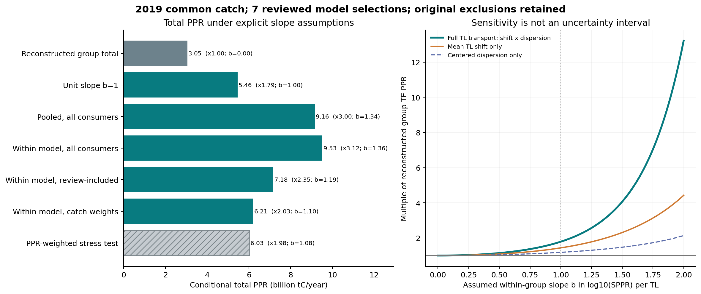
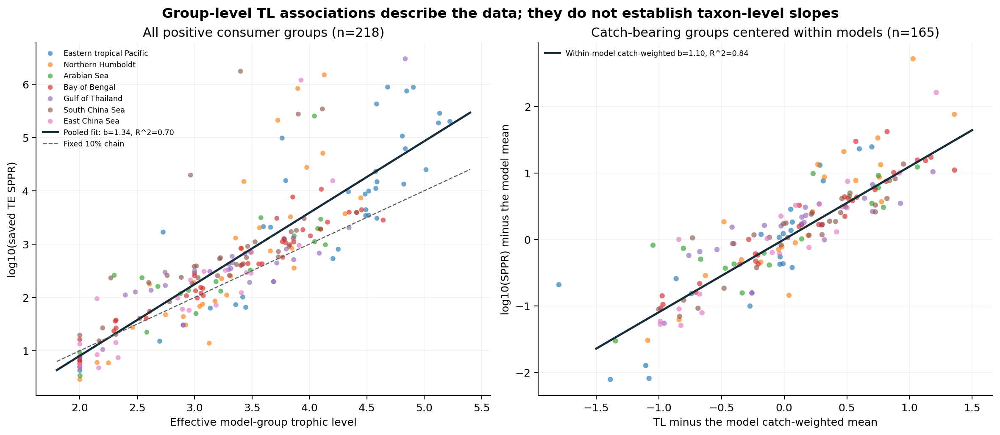

# TE PPR at taxon resolution: current validated cohort

This successor analysis uses the current exact validated cohort following withdrawal of researcher validation for `(LME_028, 28_646_Guinea_(1998))`. The earlier 16 October studies remain historical and unchanged. The active review decision determines cohort membership; it does not alter saved model inputs, coefficients, numerical diagnostics or method eligibility.

The reconstructed TE baseline is **3.051529 billion tC**. The within-ecosystem catch-weighted, review-included and all-consumer scenarios produce **6.208042**, **7.176716** and **9.525653 billion tC**, respectively: factors of **2.034404**, **2.351843** and **3.121601** relative to baseline. These are conditional arithmetic projections, not confidence bounds, a measured world total, or a reconstructed taxon food web.

## Scope and evidence

The [cohort manifest](inputs/cohort.json) binds **7 exact model-region pairs** to the final Project fingerprint and actual signed review identities: HS_077, LME_013, LME_032, LME_034, LME_035, LME_036, LME_047. The withdrawn Guinea pair is excluded from all calibration, allocation, scenario and influence calculations in this successor. The 1985 Guinea candidate is not substituted. Separate upstream reference overlays remain context only and are not fitted observations or catch contributors.

All totals use **2019 total catch including discards**, **all basal sources**, unidentified treatment **method**, saved `new_TE_EEfix` coefficients, and the remaining models' signed-review default group exclusions. Original allocation shares are retained; excluded shares are not redistributed. The comparison contains **39,684,336.471269 tonnes** of allocated catch, **165 catch-bearing groups**, **1,693 region–taxon records**, and **2,624 taxon–group allocations**. Region–taxon records are not distinct biological species: taxa can recur across ecosystems and include broader catch categories.

The source experiment supplies 219 consumer-group coefficients. 218 are positive and enter log fits; zero-valued coefficients: 1. The review-included positive calibration sample has 202 groups. Expected counts come from the new upstream records and aggregation package, then are independently checked against current published taxon allocations. [The count manifest](inputs/sample_manifest.json) is evidence for this cohort, not a reusable hardcoded sample size.

Taxon TL is `1 + log10(saved simple_sppr)`. Model-group TL is `1 + log10(saved SPPR_1995_TE0.1)`, retaining the cycle-pruned/detritus-basal effective coordinate. It is not silently replaced with the ordinary displayed model TL. Treating the two TL conventions as comparable is an explicit projection assumption.

## Reconstruction and conditional prediction

Let `c_ig` be catch allocated to group `g`, `C_g = sum_i c_ig`, `S_g` its saved TE coefficient, `T_i` taxon TL and `T_g` effective group TL. The project carbon conversion gives `PPR0 = sum_g(C_g S_g)/9`.

The anchored projection is `s_ig(b) = S_g × 10^[b(T_i − T_g)]`. It retains each observed group coefficient, including its departure from the descriptive regression line. It assumes that a slope observed between functional groups also applies to taxa within those groups. Neither the regression nor this calculation establishes that assumption.

With allocation shares `q_ig = c_ig/C_g` and mean taxon TL `mu_g = sum_i q_ig T_i`, the exact multiplier is:

`R_g(b) = 10^[b(mu_g − T_g)] × sum_i q_ig 10^[b(T_i − mu_g)]`.

The first factor is the mean TL shift. The second is centered Jensen curvature, at least one. The full total is the sum of `c_ig S_g 10^[b(T_i − T_g)]/9` over actual allocations. A mean shift may be negative, so convexity alone does not guarantee that the full total exceeds baseline. Group factors must be weighted by this method's own baseline PPR contributions `C_g S_g / sum_h C_h S_h`.

This calculation does not rerun diets, mortality, detritus recycling, efficiency or feedback equations, and does not enforce flow balance in a finer network. A group network can already contain the cost of mixed diets: for two equally weighted terminal consumers with costs 10 and 100, a correctly aggregated linear diet calculation may already retain their mean cost 55, while the classic coefficient at mean TL is only 31.62. Thus an exponential TL projection is a sensitivity assumption, not a universal correction for network aggregation.

The fitted response is log SPPR. Anchoring retains each existing group residual, so no additional residual-smearing multiplier is applied; that would count the same observed group heterogeneity again. Unknown within-group residual variation remains unidentified. Scenario spread is not an estimated distribution of ecological true PPR.

## Numerical results

| Saved-coefficient reconstruction | Billion tC |
|---|---|
| Grouped classic | 1.576233 |
| Taxon simple chain | 2.917923 |
| TE baseline | 3.051529 |

| Conditional scenario | Slope b | Billion tC | Factor over baseline |
|---|---|---|---|
| Retain group coefficients | 0.000000 | 3.051529 | 1.000000 |
| Unit slope b=1 | 1.000000 | 5.458401 | 1.788743 |
| All positive consumers, pooled ecosystems | 1.341003 | 9.159593 | 3.001641 |
| All positive consumers, within ecosystems | 1.362780 | 9.525653 | 3.121601 |
| Review-included consumers, pooled ecosystems | 1.186852 | 7.088277 | 2.322861 |
| Review-included consumers, within ecosystems | 1.194855 | 7.176716 | 2.351843 |
| Catch-bearing groups, equal weights, pooled ecosystems | 1.123142 | 6.444940 | 2.112037 |
| Catch-bearing groups, equal weights, within ecosystems | 1.098775 | 6.224970 | 2.039952 |
| Catch weights, pooled ecosystems | 1.094218 | 6.185307 | 2.026954 |
| Catch weights, within ecosystems | 1.096836 | 6.208042 | 2.034404 |
| PPR weights; stress test, pooled ecosystems | 1.128200 | 6.492316 | 2.127562 |
| PPR weights; stress test, within ecosystems | 1.075675 | 6.028489 | 1.975564 |

All 12 scenarios use identical catch support. The pooled and within fits are recomputed from the new cohort rather than subtracting Guinea from an old fitted result. PPR weighting uses the response itself and is retained as an influence stress test, not a preferred estimator.

At fixed slope b=1, the full factor is **1.788743**, decomposing sequentially into a mean-shift factor **1.437692** and additional dispersion factor **1.244177**. The centered-Jensen-only factor **1.182460** answers a different question because it omits mean shifts. The sequential full/shift decomposition is not the product of independently averaged group factors.

## Refitted descriptive relationships

Five calibration choices are retained: all positive consumers, review-included consumers, catch-bearing groups with equal weights, catch weights and method-specific PPR weights. Pooled regressions fit one intercept; within regressions fit an intercept per ecosystem; between regressions fit one weighted centroid per ecosystem with equal weight per ecosystem. These are descriptions of functional groups, not independent-species regressions.

| Calibration and design | Slope | R² | Observations | Models |
|---|---|---|---|---|
| All positive consumers, pooled ecosystems | 1.341003 | 0.703304 | 218 | 7 |
| All positive consumers, within ecosystems | 1.362780 | 0.665102 | 218 | 7 |
| All positive consumers, between ecosystems | 1.280731 | 0.916622 | 7 | 7 |
| Review-included consumers, pooled ecosystems | 1.186852 | 0.801222 | 202 | 7 |
| Review-included consumers, within ecosystems | 1.194855 | 0.770576 | 202 | 7 |
| Review-included consumers, between ecosystems | 1.173462 | 0.964888 | 7 | 7 |
| Catch-bearing groups, equal weights, pooled ecosystems | 1.123142 | 0.815491 | 165 | 7 |
| Catch-bearing groups, equal weights, within ecosystems | 1.098775 | 0.756552 | 165 | 7 |
| Catch-bearing groups, equal weights, between ecosystems | 1.196532 | 0.969513 | 7 | 7 |
| Catch weights, pooled ecosystems | 1.094218 | 0.814093 | 165 | 7 |
| Catch weights, within ecosystems | 1.096836 | 0.841109 | 165 | 7 |
| Catch weights, between ecosystems | 1.194513 | 0.954322 | 7 | 7 |
| PPR weights; stress test, pooled ecosystems | 1.128200 | 0.848807 | 165 | 7 |
| PPR weights; stress test, within ecosystems | 1.075675 | 0.657914 | 165 | 7 |
| PPR weights; stress test, between ecosystems | 1.142348 | 0.943230 | 7 | 7 |

There are 7 food webs, not 219 independent ecosystem replicates. A positive TL association does not identify a universal transfer efficiency, a causal within-group slope or feedback omitted by the cycle-pruned TL coordinate.

## Leave-one-model-out calibration sensitivity

Each refit omits one model from calibration, then applies that slope to the same full current 7-model catch support. It does not remove the held-out model's catch from the scenario. The 70 refits and 21 per-model fits are saved in [regressions.json](results/regressions.json).

| Fit | Omission-refitted slope range | Full-cohort scenario range, billion tC |
|---|---|---|
| All positive consumers, pooled ecosystems | 1.288861–1.381217 | 8.364129–9.852595 |
| All positive consumers, within ecosystems | 1.294128–1.436813 | 8.439629–10.942294 |
| Catch weights, pooled ecosystems | 1.033629–1.159738 | 5.698608–6.801740 |
| Catch weights, within ecosystems | 1.036506–1.167083 | 5.720098–6.877418 |
| PPR weights; stress test, pooled ecosystems | 0.941529–1.196597 | 5.085253–7.196203 |
| PPR weights; stress test, within ecosystems | 0.995298–1.147470 | 5.426372–6.678436 |
| Catch-bearing groups, equal weights, pooled ecosystems | 1.076054–1.160601 | 6.031619–6.810560 |
| Catch-bearing groups, equal weights, within ecosystems | 1.044108–1.138265 | 5.777634–6.588400 |
| Review-included consumers, pooled ecosystems | 1.129577–1.215689 | 6.505316–7.415610 |
| Review-included consumers, within ecosystems | 1.121325–1.234239 | 6.428064–7.639345 |

These ranges describe calibration sensitivity, not confidence intervals for true PPR. Group and regional influence remain descriptive diagnostics and do not authorize further exclusions.

## Retained diagnostic restrictions

Positive researcher review concerns the model extraction and signed diagnostics; it does not approve every additional coefficient, transformed calculation or annual outcome. The following saved flags remain in force. A finite reconstructed total is not a new annual publication permission.

| Region | Saved diagnostic | Published annual status | rho living | EE floor |
|---|---|---|---|---|
| HS_077 | WARN | provisional: diagnostic WARN; strict SPPR balance check failed | 0.6272053418305534 | True / 0.1 |
| LME_013 | WARN | provisional: DIRECT TE overall FAIL; balanced model; det_collapse_mode=always; pending researcher review; production-ineligible | 0.7316477059387119 | True / 0.1 |
| LME_032 | WARN | ok | 0.6727157264791674 | True / 0.1 |
| LME_034 | OK | provisional: printed input plus researcher Detritus completions; separate runtime normalization; derived biomass accumulation; source fidelity unverified; diagnostic OK | 0.6258323201690972 | True / 0.1 |
| LME_035 | WARN | provisional: assumed size/stage allocations; see allocation ledger | 0.6142385860404651 | True / 0.1 |
| LME_036 | WARN | provisional: assumed size/stage allocations; see allocation ledger | 0.6163296517365333 | True / 0.1 |
| LME_047 | WARN | ok | 0.784123563218391 | True / 0.1 |

## Reproducibility

[Source hashes](inputs/source_hashes.json) bind the current cohort, generated pages, canonical model/source packages and transitive upstream results. [Analysis verification](evidence/verification.json) records direct-sum identities and actual runtime. [Independent verification](evidence/independent_verification.json) reconstructs catch allocations from current HTML and solves separate weighted design matrices for pooled, within, between, per-model and leave-one-model-out fits. [Figure review](evidence/figure_review.json) records visual checks of the regenerated figures. No production model solver, regional workbook recalculation or page publication is performed by this research package.
