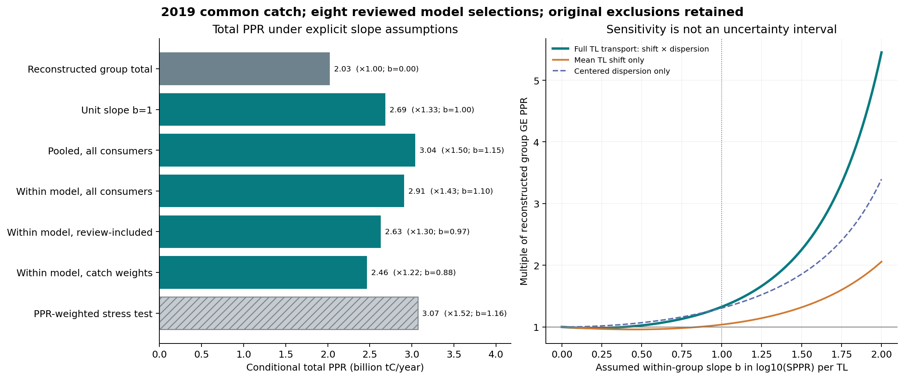
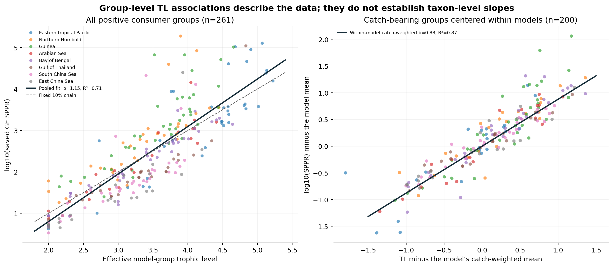

# GE PPR at taxon resolution

This study repeats the preceding [TE analysis](../ppr_taxonomic_resolution_20261016/report.md) using `SPPR_new` with `TE_option='GE'`. It estimates conditional changes in the total PPR of the same catch when taxon-specific costs are predicted from the observed group-level relationship between SPPR and trophic level. It does not rebuild a taxon-level food web or identify ecological true PPR.

**Main result:** the reconstructed GE baseline is **2.026 billion tC**. The catch-weighted within-ecosystem fit predicts **2.465 billion tC (1.217 times baseline)**; the review-included fit predicts **2.629 billion tC (1.297 times)**; and the all-consumer fit predicts **2.907 billion tC (1.435 times)**. These are conditional increases of approximately **22–43%**, compared with **41–90%** in the corresponding TE scenarios. They are not confidence limits. The review-included GE projection is **1.448 times the grouped classical calculation**, but only **0.830 times the taxon simple-chain calculation**.

## 1. Exact scope of the replication

The evaluation retains 2019 total catch including discards, `all` basal sources, unidentified treatment `method`, and the same eight default selected model-region pairs: HS_077, LME_013, LME_028, LME_032, LME_034, LME_035, LME_036 and LME_047. Signed-review default group exclusions remain applied with the original mapping shares; omitted shares are not redistributed.

This is the same 44,153,491.45 tonnes of allocated catch, 200 catch-bearing groups, 2,018 region–taxon records and 3,089 taxon–group allocations as the TE comparison. The taxon count is not a count of distinct biological species. Some catch categories are broader than species, and taxa can occur in several regions.

Taxon TL is recovered as `1 + log10(simple_sppr)`. Model-group TL is recovered as `1 + log10(SPPR_1995_TE0.1)`, preserving the effective cycle-pruned, detritus-as-basal coordinate used in the original experiment. It is not silently replaced with the ordinary displayed group TL. The reference taxon TL and model-derived TL are treated as comparable for the projection, although their conventions and sources differ.

The original experiment contains 261 positive GE consumer coefficients, compared with 260 positive TE coefficients and one TE zero. The additional GE-positive record is Eastern Tropical Pacific `Toothed whales`. It is excluded by the existing review defaults, so the all-consumer GE fit has 261 observations while the review-included fit remains at 241, as in TE. Evaluation catch support remains 200 groups. There are no missing, zero or negative GE consumer coefficients in this source experiment; this fact does not remove diagnostic restrictions.

## 2. What changes scientifically when selecting GE

The consumer efficiency becomes

\[
GE_i=P_i/Q_i,
\]

whereas the TE option uses effective `(P_i − M0_i)/Q_i`. This is not the only difference. In the project implementation, GE also solves the detritus recycling equations, while TE uses direct primary-producer/import ancestry for detritus, with its documented dead-end treatment.

For GE, the living-network coefficients use `A_ij = DC_ij/GE_i`. The detritus values then satisfy

\[
\mathbf{x}=\mathbf{c}+B\mathbf{x},
\qquad
(I-B)\mathbf{x}=\mathbf{c}.
\]

Here `B` describes recycling through consumers and detritus. Under the GE convention, nonpredatory mortality supplies credited detrital burden; egestion contributes to total detrital inflow but does not receive the same credited burden. A convergent nonnegative recycling interpretation requires the relevant spectral radius to be below one. A finite or positive coefficient alone does not establish that condition.

The saved model-specific settings are retained, including their EE-floor configuration and detritus treatment. GE's consumer ratio `P/Q` is not directly changed by an EE floor that holds P and Q fixed, but GE's detritus equations can change when the floor changes M0 and detrital inflows. Therefore, GE must not be described as automatically floor-independent.

These definitions are documented in [SPPR methods](../../../explainers/sppr_methods.md) and [parameters](../../../explainers/sppr_parameters.md), and were checked against the calculator. This study reads the resulting saved GE coefficients; it does not rerun those equations or substitute generic defaults for audited regional settings.

## 3. The same mathematical pipeline

Let `c_ig` denote the catch of taxon `i` allocated to group `g`, and `C_g = sum_i c_ig`. Let `S_g` be its saved **GE** coefficient. The reconstructed baseline is

\[
PPR_{GE,0}=\frac{1}{9}\sum_gC_gS_g.
\]

The factor nine is the same project carbon conversion and cancels from ratios. The slope is estimated from

\[
\log_{10}S_g=a_{ecosystem}+bT_g+\varepsilon_g.
\]

The pipeline retains pooled, within-ecosystem and between-ecosystem descriptions. Within-ecosystem regressions permit a separate intercept for each ecosystem. None measures a response between taxa inside one functional group. The same five calibration choices are retained: all consumers, review-included consumers, fished groups with equal weights, catch-weighted groups, and PPR-weighted groups. PPR weights now use **GE** PPR, as required by the equivalent procedure; TE PPR weights are not reused.

The conditional taxon coefficient is

\[
\boxed{\widehat s_{ig}(b)=S_g10^{b(T_i-T_g)}}.
\]

This retains the actual group coefficient and its multiplicative departure from the fitted relationship. It assumes that the chosen between-group TL slope also applies within groups. It does not construct a disaggregated network or enforce its flow balance.

Write `w_ig = c_ig/C_g` and `mu_g = sum_i w_ig T_i`. The predicted group multiplier separates exactly:

\[
\widehat R_g(b)=
\underbrace{10^{b(\mu_g-T_g)}}_{M_g:\ \text{mean TL adjustment}}
\underbrace{\sum_iw_{ig}10^{b(T_i-\mu_g)}}_{J_g(b):\ \text{Jensen adjustment}}.
\]

`J_g` is at least one, while `M_g` can be above or below one. The full total is calculated directly over taxon allocations:

\[
\widehat{PPR}_{GE}(b)=\frac{1}{9}\sum_g\sum_i c_{ig}S_g10^{b(T_i-T_g)}.
\]

Equivalently, the group multipliers are averaged with the **GE baseline PPR weights** `omega_g = C_g S_g / sum_h C_h S_h`. Using TE weights instead would answer a different question.

Three separate projections are retained: mean adjustment only, centered Jensen only, and the full adjustment. The exact aggregate decomposition uses sequential totals:

\[
\frac{PPR_{full}}{PPR_0}
=\frac{PPR_{shift}}{PPR_0}
\frac{PPR_{full}}{PPR_{shift}}.
\]

It is not the product of two separately averaged group multipliers.

The code also repeats all leave-one-ecosystem-out fits, then reapplies each estimated slope to the unchanged full catch cohort. Such ranges are calibration sensitivities, not confidence intervals for true PPR.

## 4. Numerical results

### Baseline and all twelve scenarios

| Calculation on the identical catch | PPR, billion tC |
|---|---:|
| Grouped classical calculation | 1.815041 |
| Taxon simple-chain calculation | 3.168634 |
| Reconstructed GE group baseline | 2.026100 |
| Reconstructed TE group baseline | 8.038957 |

The GE baseline is **1.116 times grouped classic**, **0.639 times taxon simple chain**, and **0.252 times the TE baseline**. These are arithmetic comparisons under different accounting conventions, not measurements of which method is closest to truth.

| GE scenario | Slope `b` | Total, billion tC | Factor over GE baseline |
|---|---:|---:|---:|
| Retain group coefficients | 0.000000 | 2.026100 | 1.000000 |
| Unit slope | 1.000000 | 2.686219 | 1.325808 |
| All consumers, pooled | 1.146662 | 3.041928 | 1.501371 |
| All consumers, within ecosystems | 1.096448 | 2.907290 | 1.434920 |
| Review-included, pooled | 1.034531 | 2.760143 | 1.362294 |
| Review-included, within ecosystems | 0.971287 | 2.628815 | 1.297476 |
| Fished groups, equal weights, pooled | 1.021814 | 2.732275 | 1.348539 |
| Fished groups, equal weights, within ecosystems | 0.903282 | 2.506349 | 1.237032 |
| Catch-weighted, pooled | 0.976604 | 2.639178 | 1.302590 |
| Catch-weighted, within ecosystems | 0.877695 | 2.464811 | 1.216530 |
| PPR-weighted, pooled; stress test | 1.200184 | 3.202520 | 1.580633 |
| PPR-weighted, within ecosystems; stress test | 1.157544 | 3.073084 | 1.516749 |

The headline 22–43% comparison uses the same three within-ecosystem scenarios emphasized in the TE report. It is not the range of every fitted design: the all-consumer pooled fit gives +50.1%, and the outcome-weighted stress tests give +51.7% and +58.1%. No scenario is promoted to an identified estimate of biological truth.

The full numeric precision, regional subtotals and group contributions are in [scenarios.json](results/scenarios.json), [group_transport.json](results/group_transport.json), and [summary.json](results/summary.json).

### GE slope estimates and their interpretation

The all-consumer within-ecosystem slope is **1.096448**, with within-log-scale `R² = 0.716057`. One TL is associated with `10^1.096448 = 12.49` times GE SPPR between groups, compared with approximately 23.7 under the TE slope. This is a descriptive association, not a measured universal efficiency.

Restricting calibration to review-included groups gives slope **0.971287** and within `R² = 0.826765`. Catch weighting gives slope **0.877695** and within `R² = 0.870172`. These R-squared values use their respective samples and weights; they do not establish which slope predicts taxon costs best.

Leave-one-ecosystem-out fits reproduce the TE pipeline's calibration-sensitivity check:

| Within-ecosystem calibration | Omission slope range | Projected full-cohort PPR, billion tC |
|---|---:|---:|
| All consumers | 1.069806–1.117566 | 2.841563–2.962139 |
| Review-included | 0.936707–0.993013 | 2.564268–2.671921 |
| Catch-weighted | 0.839840–0.911081 | 2.407550–2.519485 |

Only the slope-fitting sample changes in this check; every prediction evaluates the full unchanged catch cohort. The ranges do not include uncertainty about diets, taxon efficiencies, mappings, floor application, network topology or the validity of transporting a between-group slope within groups.

### Separating mean TL and Jensen contributions

For the unit-slope scenario, the sequential totals are

\[
2.026100\ \longrightarrow\ 2.101870\ \longrightarrow\ 2.686219
\quad\text{billion tC}.
\]

First adjust each group to its catch taxa's mean TL, then account for their individual TLs. The exact total factor is

\[
1.325808=1.037397\times1.278014.
\]

The mean adjustment adds 3.74%; dispersion adds 27.80% to that shifted total; their combined increase is 32.58%. The centered-Jensen-only result is **2.644842 billion tC**, or **1.305386 times baseline**, which omits the mean adjustment.

The main fitted scenarios decompose as follows:

| Calibration | Mean adjustment | Jensen after mean adjustment | Full factor |
|---|---:|---:|---:|
| Catch-weighted, within | 1.004621 | 1.210934 | 1.216530 |
| Review-included, within | 1.028741 | 1.261227 | 1.297476 |
| All consumers, within | 1.071236 | 1.339499 | 1.434920 |

For example, the review-included result first raises GE PPR from 2.026100 to 2.084331 billion tC, then to 2.628815 billion tC. It includes the whole stipulated TL adjustment, not Jensen alone.

### Direct comparison with TE

| Same scenario design | GE total, billion tC | GE factor | TE total, billion tC | TE factor |
|---|---:|---:|---:|---:|
| Reconstructed group baseline | 2.026 | 1.000 | 8.039 | 1.000 |
| Unit slope | 2.686 | 1.326 | 10.173 | 1.266 |
| Catch-weighted, within | 2.465 | 1.217 | 11.355 | 1.412 |
| Review-included, within | 2.629 | 1.297 | 12.562 | 1.563 |
| All consumers, within | 2.907 | 1.435 | 15.303 | 1.904 |
| PPR-weighted, within; stress test | 3.073 | 1.517 | 39.426 | 4.904 |

Two distinct changes explain this comparison. First, GE has different group coefficients, so its total PPR weights differ. At a common specified slope such as `b=1`, each group's mean-shift and Jensen factors are identical in GE and TE, because its catch and TL inputs are identical. Nevertheless, the overall GE factor is **larger** than TE's at this fixed slope, owing to those different weights. The GE mean-shift factor is 1.037397, while TE's is 0.963231.

Second, the fitted GE slopes are lower. Refitting the same designs for GE therefore reduces the projected adjustment relative to the corresponding fitted TE scenarios. It would be incorrect to attribute the entire GE/TE difference to a universally weaker GE Jensen effect, or to reuse a TE-fitted slope as though it had been estimated for GE. [ge_te_comparison.json](results/ge_te_comparison.json) retains both sides and labels fixed-slope versus refitted comparisons.

The final comparisons with the classical references are:

| GE calculation | Relative to grouped classic | Relative to taxon simple chain |
|---|---:|---:|
| Baseline | 1.116283 | 0.639424 |
| Catch-weighted, within | 1.357992 | 0.777878 |
| Review-included, within | 1.448350 | 0.829637 |
| All consumers, within | 1.601777 | 0.917522 |

Consequently, **these principal GE taxon projections remain below the 3.169 billion tC taxon simple-chain estimate**, although they exceed grouped classic. The large TE totals in the earlier study do not carry over when the same pipeline is applied to GE. This is a result for this cohort and these saved method configurations; it is not a theorem that GE must be below TE in every food web.

### Influence and diagnostic restrictions

Guinea contributes **48.72%** of the GE baseline, compared with 62.04% under TE. Its `Sélaciens L prof` group contributes **12.47%** of GE baseline, compared with 38.70% under TE. Under `b=1`, that group's GE PPR falls from **0.252714 to 0.219577 billion tC**, because its mean-TL adjustment outweighs its dispersion effect.

At regional scale under `b=1`, South China Sea gives the largest increase, **0.215618 billion tC**, despite supplying only 2.65% of baseline. Northern Humboldt adds **0.169778 billion tC**; Arabian Sea adds **0.110498 billion tC**. Eastern Tropical Pacific decreases by **0.063503 billion tC**. The full regional and group rankings are retained in the summary.

The source diagnostic statuses are method-specific:

| Region | GE diagnostic | Recorded recycling gain | Living spectral radius |
|---|---|---:|---:|
| Eastern Tropical Pacific | WARN | 0.000000 | 0.538726 |
| Northern Humboldt | FAIL | 1.623573 | 0.700000 |
| Guinea | OK | 0.354813 | 0.449723 |
| Arabian Sea | WARN | 0.515961 | 0.576695 |
| Bay of Bengal | OK | 0.174458 | 0.585823 |
| Gulf of Thailand | OK | 0.269628 | 0.240000 |
| South China Sea | WARN | 0.004486 | 0.320919 |
| East China Sea | WARN | 0.198686 | 0.687410 |

The recycling gain in this table is the saved diagnostic quantity, distinct from the regression slope also denoted `b` elsewhere. The full diagnostic includes additional criteria; a gain below one alone does not establish overall OK.

Guinea GE is diagnostic OK and annual `ok`; its TE-specific annual implausibility restriction must not be transferred to GE. Northern Humboldt GE retains a **FAIL** restriction and production-ineligible provisional annual status. It supplies **11.66% of GE baseline**. Its current manifest records `det_collapse_mode='auto'`, `method='pooled_detritus_scaling'`, and `would_pool=true`, with a recycling gain above one. The annual status text retains the historical phrase `det_collapse_mode=always`; that prose is not substituted for the current diagnostic configuration. The saved negative detritus-stock residual is approximately -4337.380255 in the source diagnostic's units.

Other provisional source-fidelity and size/stage-allocation restrictions also remain. The totals are diagnostic reconstructions from finite coefficients; this replication neither promotes a FAIL result nor establishes that all eight annual totals are production-eligible.

## 5. What the GE projection can establish about true PPR

The projected total includes the mean-TL shift and the within-group dispersion effect. Neither an additional classical Jensen multiplier nor an across-group residual smearing factor should be applied automatically. The actual group coefficient already retains its observed regression residual; the unobserved taxon-to-group residual change has not been estimated.

For positive coefficients, define

\[
\eta_{ig}=\ln(s^*_{ig}/S_g)-b\ln(10)(T_i-T_g).
\]

Then the actual group multiplier can be written `R_g* = M_g J_g N_g`, where

\[
N_g=\sum_i h_{ig}e^{\eta_{ig}},
\qquad
h_{ig}=\frac{w_{ig}10^{b(T_i-\mu_g)}}{J_g}.
\]

The anchored projection sets this remaining weighted factor to one. Actual taxon diets, efficiencies, selectivity, living feedback and detritus recycling can move it above or below one. The group-level scatter does not identify it.

There is also an alternative interpretation of the group coefficient. Under a flow-preserving terminal-group merge with fixed upstream prey costs and no relevant feedback, GE satisfies

\[
S_g=\frac{\sum_iP_i s_i}{\sum_iP_i}.
\]

Thus the group coefficient can already be a production-weighted average of taxon costs. Catch needs a catch-weighted average. If those weights coincide, the fine/coarse PPR ratio is one even when taxa differ in TL. With production weights `v_i = P_i/sum_j P_j`, a shape prediction respecting that averaged anchor would instead give

\[
\widehat R_g=
\frac{\sum_iw_i10^{b(T_i-T_g)}}
     {\sum_iv_i10^{b(T_i-T_g)}}.
\]

Taxon production weights are not supplied by the catch–TL records. The present numerical pipeline therefore remains the explicitly stipulated anchored projection, not an identified correction for biological aggregation bias. The production weights in this GE example differ from the effective-output weights `P_i − M0_i` in the corresponding TE example.

Controlled reaggregation of trustworthy detailed models remains the direct way to test the prediction: compute fine-model PPR, merge ecological groups while preserving production/consumption/mortality/diet flows and detritus routing, recompute coarse-model PPR under a consistent floor policy, and assess whether the proposed correction predicts the known difference in held-out models.

These totals describe the selected eight-model catch cohort. Extrapolation to a world total requires an additional coverage and representativeness model; they are not a measured global total or a validated interval for ecological true PPR.

## 6. Evidence and reproduction

The [README](README.md) links code, full numerical outputs, figures and source hashes. The [process record](evidence/process.md) records the design and checks. Both the [analysis verification](evidence/verification.json) and [independent verification](evidence/independent_verification.json) distinguish arithmetic reproducibility from biological validity.

The original TE study, original trophic-level experiment, source scientific files, model selections, researcher reviews and published HTML remain unchanged. The new package and its research-index entry are the outputs of this request.
